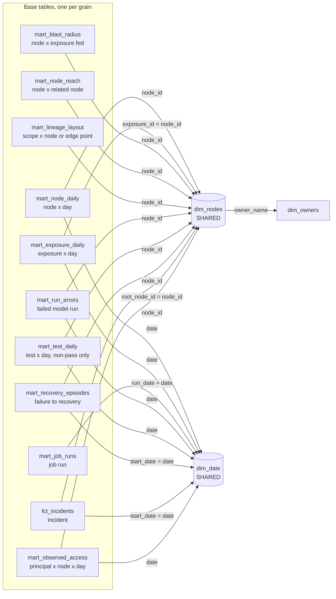

# Lineage Control Tower: Tableau data model

One Tableau data source, built as a **multi-fact relationship model** (Tableau 2024.2 or later, including Tableau Public). Two shared dimension tables sit in the middle, and every fact-style table relates to them. Tableau connects to the **mart layer** in `data/marts/`, not to the raw generated tables.

## Why marts, not the raw tables

A multi-fact model has one rule that shapes everything: **a sheet cannot combine a dimension from one fact table with a measure from another.** Tables are only stitched together through the shared dimensions.

A lot of what this dashboard shows crosses fact tables. Some examples:

- An exposure's status is the worst current status of every node upstream of it (closure table × model runs × tests × freshness × refreshes).
- A lineage node's colour comes from its latest run, which lives in a different table from its x/y position.
- A blast radius row needs the exposure's owner, Slack channel and consumers on the same row as the upstream node.

So `generator/marts.py` pre-computes that graph logic, the way a `dbt_ops` project would in production. Tableau then does what it is good at: filtering, aggregating, interaction and design. As a bonus, the workbook drops from about 400k rows to about 37k, which keeps it fast on Tableau Public.

```
python generator/aggregate.py data mockup/data/lct_agg.json         # shared logic, also feeds the HTML mockup
python generator/marts.py data mockup/data/lct_agg.json data/marts   # writes the 14 CSVs below
```

The raw tables stay in `data/` for transparency and for anyone who wants to rebuild the marts in dbt.

## The model



### Relationships to create

| Base table | → dim_nodes | → dim_date |
|---|---|---|
| mart_node_daily | node_id = node_id | date = date |
| mart_exposure_daily | exposure_id = node_id | date = date |
| mart_blast_radius | node_id = node_id | (none) |
| mart_node_reach | node_id = node_id | (none) |
| mart_lineage_layout | node_id = node_id | (none) |
| mart_job_runs | (none) | run_date = date |
| mart_run_errors | node_id = node_id | date = date |
| mart_test_daily | node_id = node_id | date = date |
| mart_recovery_episodes | node_id = node_id | start_date = date |
| fct_incidents | root_node_id = node_id | start_date = date |
| mart_observed_access | node_id = node_id | date = date |

Plus one downstream table: **dim_nodes → dim_owners** on `owner_name = owner_name`. Exposures without an owner carry `No owner`, which has its own row.

Leave every relationship's performance options on the defaults (many-to-many, some records match).

## Table reference

| Table | Grain | Rows | Key columns | Used on |
|---|---|---|---|---|
| **dim_nodes** (shared) | one row per source, model, semantic object or exposure | 148 | node_id, node_key | every tab |
| **dim_date** (shared) | one row per day, 22 Jul to 19 Oct 2026 | 90 | date, days_before_as_of | every tab with time |
| dim_owners | one row per owner, plus `No owner` | 16 | owner_name | Blast radius, Lineage panel |
| mart_node_daily | node × day | 10,620 | node_id, date, platform_on_day | Health KPIs, Runs, Quality, Freshness, Perf |
| mart_exposure_daily | exposure × day | 2,430 | exposure_id, date | Health tiles and at-risk trend, Usage, Perf cost per product |
| mart_blast_radius | upstream node × exposure it feeds | 543 | node_id, exposure_id, hops | Blast radius, Freshness "late right now" |
| mart_node_reach | node × every node it reaches, both directions | 2,554 | node_id, related_node_id, direction | Blast radius downstream path |
| mart_lineage_layout | layout scope × node box or edge point | 10,594 | layout_scope, row_type, point_order | Lineage graph |
| mart_job_runs | one dbt job run | 4,257 | job_run_id, run_date | Runs Gantt |
| mart_run_errors | one failed model run | 179 | node_id, run_started_at | Runs: why failed, recent errors |
| mart_test_daily | test × day with a warning or failure | 985 | test_id, date, weekday | Quality: tests that keep failing |
| mart_recovery_episodes | one failure to its next success | 182 | node_id, start_date, hours_to_recover | Health MTTR, Runs MTTR trend |
| fct_incidents | one incident | 8 | incident_id, root_node_id, start_date | Annotations, Health alerts |
| mart_observed_access | principal × node × day | 3,979 | principal, node_id, date, is_registered | Governance unregistered consumers |

### What `dim_nodes` carries beyond the raw attributes

`dim_nodes` holds the **current status snapshot**, because it is shared and so reachable from every sheet:

- `node_key`, `display_short` (prefix stripped for graph labels), `layer_column` (0 to 5)
- `platform_now`, `platform_filter_values` (`|snowflake|redshift|` for migrated nodes)
- `current_status_code` (0 no data, 1 healthy, 2 warning, 3 critical), `current_status`, `status_reason`, `last_event_at`, `last_run_status`, `last_runtime_sec`, `last_rows`, `last_error_message`
- `tests_passing`, `tests_warning`, `tests_failing`, `freshness_lag_min`, `last_refresh_sec`, `materialization_now`, `max_rows_built`
- `exposures_fed`, `downstream_models`, `open_incident_id`, `open_incident_started_at`
- `downstream_keys` (`|key|key|` of every node downstream) and `downstream_consumers_7d / 30d / 90d` (daily consumers of every exposure the node feeds), so Blast radius can find unregistered readers downstream and build the risk score on Node Daily
- Exposures only: `trust_badge`, `culprit_nodes`, `culprit_count`, `health_score_now`, `exposure_group`, `upstream_node_count`, `avg_daily_consumers_7d / 30d / 90d`

The consumer averages are pre-computed for the three period options, because they need an exposure-level average inside a node-level view.

## Build steps in Tableau

1. **Connect** → Text file → open `data/marts/mart_node_daily.csv`. Tableau shows the other CSVs in the folder on the left.
2. Drag in **dim_nodes** and relate it on `node_id`. Drag in **dim_date** and relate it from mart_node_daily on `date`.
3. Drag each other base table onto the **New Base Table** drop area (Tableau warns about multiple base tables, which is expected). Then drag the plus sign from that table onto dim_nodes and/or dim_date, using the fields in the table above.
4. Drag **dim_owners** next to dim_nodes and relate it on `owner_name`.
5. **Field types:**
   - Set `date`, `run_date`, `start_date` to Date.
   - Set `run_started_at`, `failed_at`, `recovered_at`, `last_event_at` to Date & Time.
   - Set `node_key`, `child_key`, `point_order`, `hops`, `day_index`, `days_before_as_of`, `layer_column` and the `_code` fields to whole numbers, then make them **dimensions** (not measures).
   - Set `x`, `y` to continuous measures.
6. **Rename** the logical tables to plain names (Node Daily, Exposure Daily, Nodes, Dates, and so on). Calculations will read better.
7. **Extract:** Tableau Public saves an extract on publish. Use the default *Logical tables* storage.
8. Hide the raw id columns you won't use (`edge_key`, `x_label` once the labels are placed, `tags`, `database_name`).
9. Save as `lineage-control-tower.twbx`. That file, with this folder, is what Claude Code works from.

**Fallback if the multi-fact model fights you:** split into four data sources, each with dim_nodes and dim_date related in:

- **Daily health:** node daily, exposure daily, episodes, incidents
- **Lineage:** layout, reach, blast radius
- **Runs:** job runs, run errors, test daily
- **Governance:** observed access

Every sheet only ever uses one base table, so nothing is lost. You only give up cross-source filtering, and that is handled by parameters anyway.

## Parameters and global filters

| Parameter | Type | Values | Set by |
|---|---|---|---|
| p_period | integer | 7, 30, 90 | Segmented buttons in the filter band |
| p_platform | string | All, snowflake, databricks, redshift | Buttons in the filter band |
| p_selected_exposure | string | exposure node_ids | Parameter action from Health tiles, Usage table, Blast radius rows |
| p_selected_node | string | node_ids | Parameter action from lineage nodes, alert list, risk table |
| p_selected_node_key | integer | node_key | Same actions as p_selected_node, drives the path highlight |
| p_gantt_date | date | 22 Jul to 19 Oct 2026, default 19 Oct | Parameter action from the daily failures chart |
| p_show_info | boolean | | Info button, drives dynamic zone visibility |
| p_tile_view | string | All, Needs attention | Buttons above the Health exposure tiles |
| p_lineage_view | string | Graph, Table | Buttons on the Lineage graph card |

The core filter calcs (full calc pack comes next):

- **In period:** `[days_before_as_of] < [p_period]`
- **In prior period:** `[days_before_as_of] >= [p_period] AND [days_before_as_of] < 2 * [p_period]`
- **Platform match (node):** `[p_platform] = "All" OR CONTAINS([platform_filter_values], "|" + [p_platform] + "|")`
- **Platform match (day):** `[p_platform] = "All" OR [platform_on_day] = [p_platform]`. Use this for daily KPIs, so migrated models count against Redshift before their move and Snowflake after.

## Which table feeds which tab

| Tab | Sheets read from |
|---|---|
| Health overview | KPI cards and sparklines: Node Daily, Episodes, Exposure Daily · tiles: Nodes (exposures) · alerts: Nodes (status ≥ 2, non-exposure) · layer health: Nodes |
| Lineage explorer | Graph: Lineage Layout + Nodes · table mode: Blast Radius filtered to the exposure · panel: Nodes + Node Daily |
| Blast radius | Blast Radius, Node Reach, Nodes, Observed Access (unregistered readers), Node Daily (risk score) |
| Run & failures | Node Daily (daily bars), Job Runs (Gantt), Run Errors, Episodes, Incidents |
| Data quality | Node Daily (heatmap uses worst_test_code), Test Daily, Nodes (coverage) |
| Freshness & SLAs | Nodes (bullets), Node Daily (compliance, calendar), Blast Radius (late sources' exposures) |
| Performance & cost | Node Daily (cost, runtime, materialization_on_day), Exposure Daily (allocated cost) |
| Usage & adoption | Exposure Daily (scatter, ranking, small multiples), Node Daily (semantic refreshes) |
| Governance | Nodes (coverage, hygiene, gaps), Observed Access (unregistered), Exposure Daily (AI-built usage) |

## Charts that will be hard in Tableau, and the plan for each

| Chart | Difficulty | Why | Plan |
|---|---|---|---|
| Copy incident message button | Not possible | Tableau cannot write to the clipboard | Show the message in a selectable text box. Add a URL action that opens Slack or a mailto link with the message pre-filled |
| Lineage graph with hover path highlight | Hard | No native network graph. Highlighting a whole path needs reachability, not just neighbours | Layout table is ready: line marks on x/y with point_order as Path, dual axis with Gantt or square marks for the node boxes, text marks at `x + 0.06`. Highlight with `CONTAINS(selected node's reach_keys, "\|" + STR([node_key]) + "\|")`. Use a click (parameter action), not hover, for speed |
| Exposure status tiles grouped by type | Medium to hard | Tiles are cards in a grid with section headers | Pre-compute tile row and column with `INDEX()` per group (or add them in marts), one sheet per group, or a single sheet with group on Rows. Shape plus text marks |
| Zombie zone in the cost vs usage scatter | Medium | Log-log axes are easy; the diagonal "over $5 per use" boundary is not a rectangle | Dual axis with a 2-point helper line for cost-per-use = $5, plus a reference band for under 10 uses in 30 days (thresholds from `generator/config.yaml`). Shade with an area mark if it reads better |
| Sparklines inside table rows (semantic refresh failures per day) | Medium | Tables and charts don't mix in one sheet | Build as one sheet: object on Rows, date on Columns, bar marks, with text columns as headers. Or a separate aligned sheet |
| Small multiples with their own axis per consumer type | Medium | Independent axes only work across rows of one axis | Four small sheets in a 2 × 2 container |
| Weekday mini bars for each failing test | Medium | Small chart per list row | Test on Rows, weekday on Columns, bar height = failure days. Header text sits in the same sheet |
| Bullet charts with per-source thresholds | Easy to medium | Each source has its own warn and error thresholds | Plot lag ÷ error threshold so every row shares one 0 to 1.25 scale. Zones are Gantt bars at warn ÷ error and 1.0 |
| Change vs prior period across 7, 30 and 90 days | Easy | 90 days has no prior period in the data | Prior-period calcs return NULL at 90 days. Format NULL as "-" with "no earlier period" |
| Gantt, heatmap, calendar, stacked bars, lines, KPI cards | Easy | Standard Tableau | Standard build |

## Handing over to Claude Code

The connected workbook is `tableau/Lineage_Control_Tower_Project_Dashboard.twb` (14 tables, 19 relationships, checked). Its CSV paths point at the owner's local copy of `data/marts/`, so reconnect to that folder if Tableau asks. The calc pack is in `docs/tableau-calc-pack.md` (every calculation, sheet list, base tables, parameters and actions, tab by tab), with paste-ready parameter lists in `docs/tableau-parameter-lists.md`.
